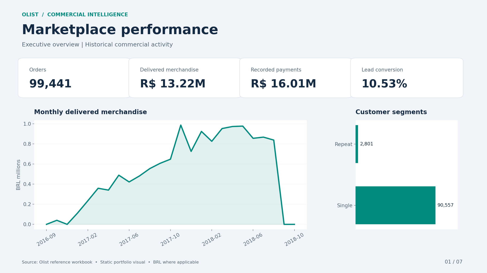
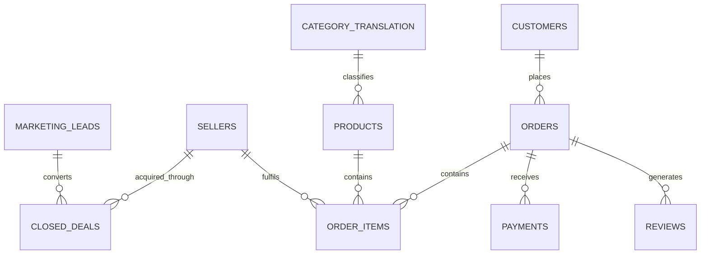
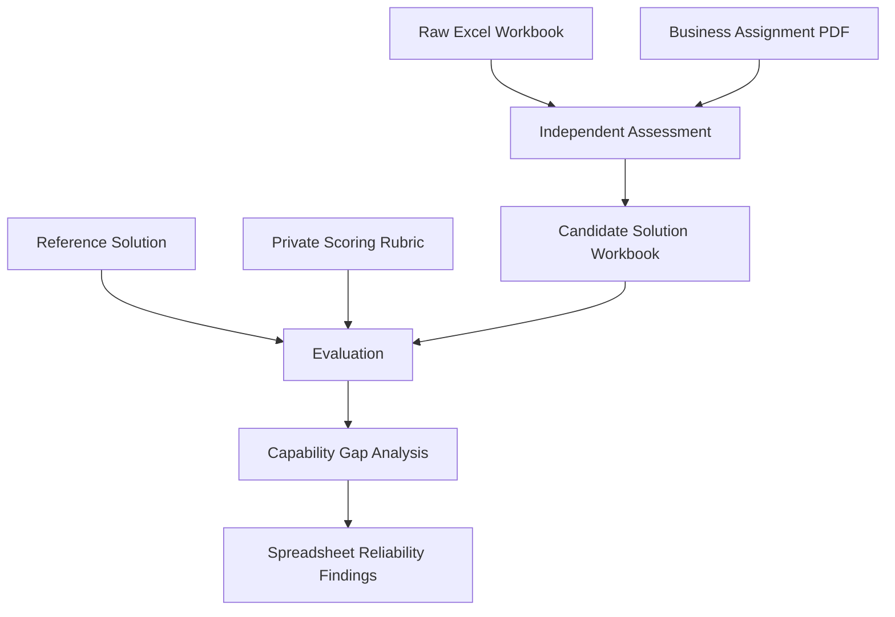
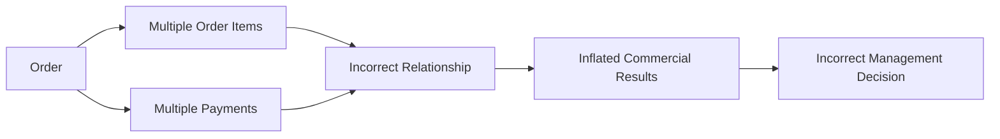
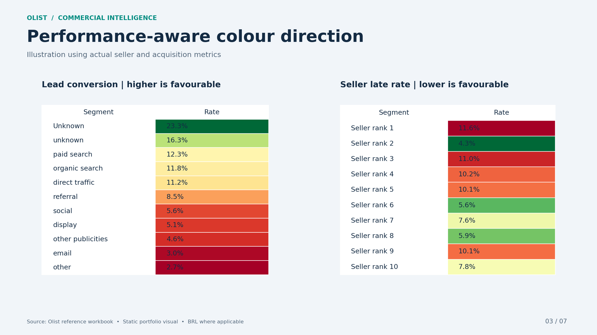
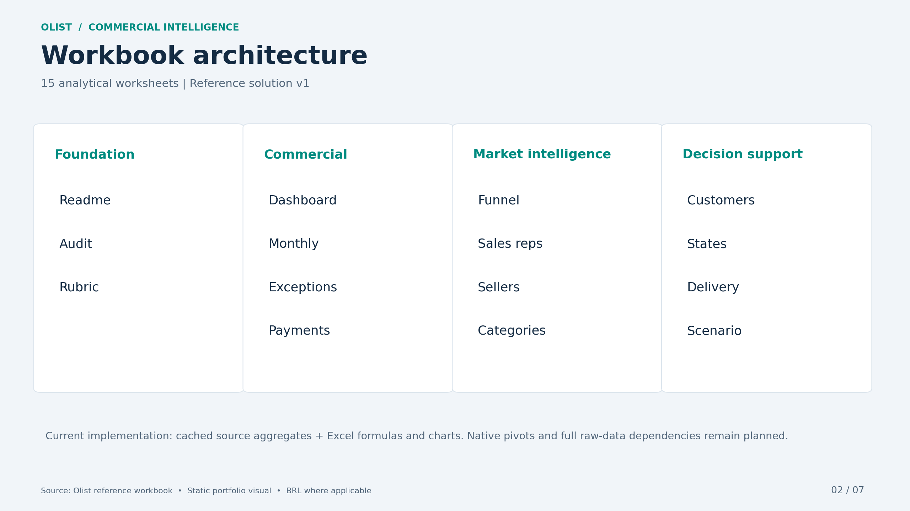
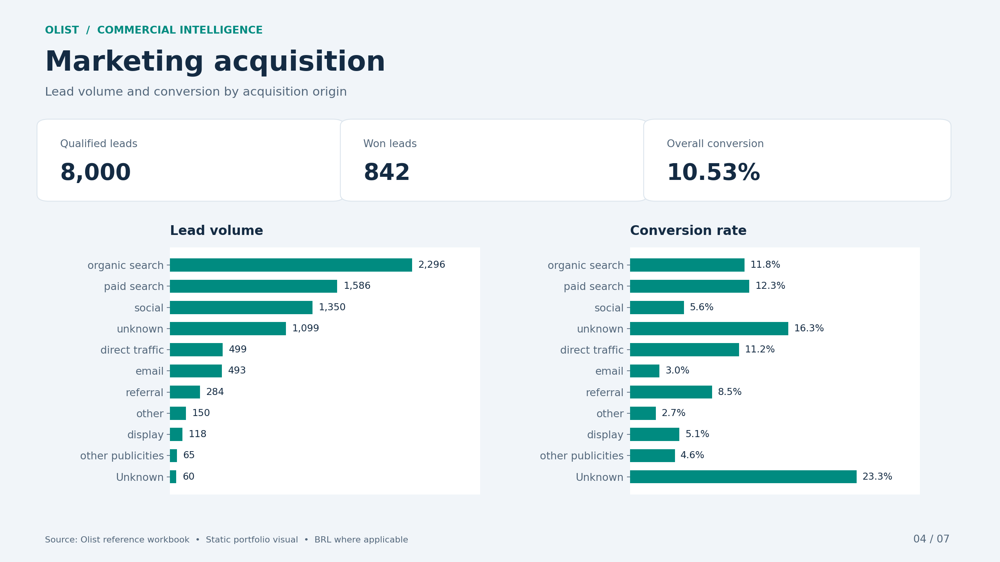
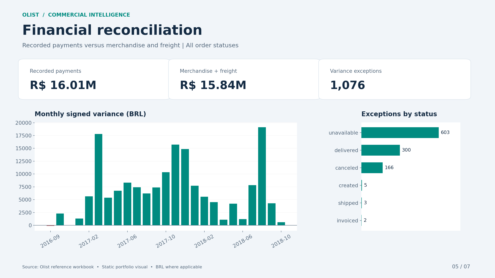
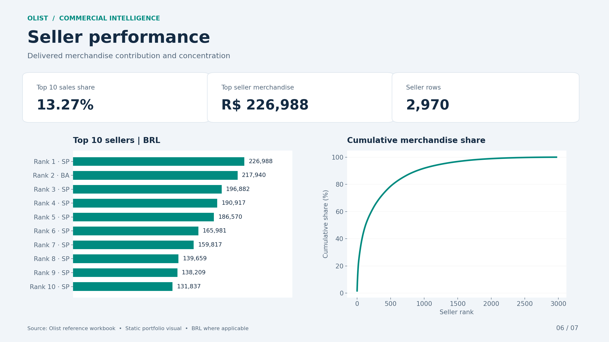
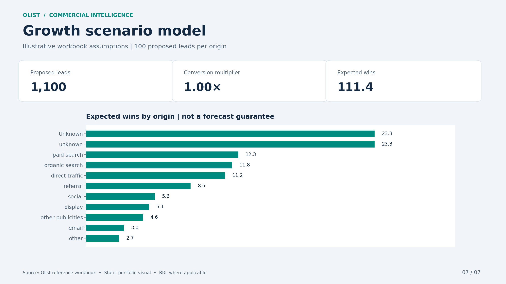

# Advanced Excel AI Stress Test

### Evaluating AI Spreadsheet Reasoning Through Real-World Commercial Analytics


---

## TL;DR

Can an AI system independently transform a complex relational dataset into a reliable, functional Excel business intelligence solution without being told which formulas, relationships or analytical methods to use?

This project investigates that question through a real-world commercial analytics assessment built around the Olist Brazilian e-commerce marketplace.

| Project Dimension | Scope |
|---|---:|
| Interconnected source tables | 10 |
| Source records | 559,000+ |
| Business assessment areas | 9 |
| Intended Excel competency areas | 30+ |
| Reference solution worksheets | 15 |
| Proposed evaluation rubric | 100 points |

The assessment tests more than numerical accuracy. It examines spreadsheet engineering, relational reasoning, financial reconciliation, dynamic calculations, visual accuracy and independent business judgement.

> A spreadsheet can contain correct formulas, attractive charts and convincing recommendations while still being fundamentally wrong.

---

## Executive Dashboard



*Reference solution showing marketplace commercial performance and management reporting.*

---

## The Business Problem

Management of an e-commerce marketplace is preparing its next growth strategy.

Before committing additional resources, management needs reliable evidence about financial performance, seller acquisition, customer retention, product performance and operational efficiency.

The available information is distributed across ten interconnected datasets.

Management requires a functional Excel solution that transforms this information into trustworthy commercial intelligence.

The challenge is not simply calculating business metrics. It is determining whether the underlying information is reliable enough to support investment decisions.

---

## The Research Question

**Can AI independently develop a reliable spreadsheet solution when the business objectives are clear but the technical implementation is entirely unspecified?**

Many spreadsheet assessments provide explicit instructions about which formulas to use, which columns to reference and how calculations should be performed.

This project deliberately removes that guidance.

The assessment provides:

- Raw relational data
- Business context
- Management objectives
- Required deliverables
- Relevant business definitions

The assessment does not provide:

- Formula names
- Lookup keys
- Data cleaning instructions
- Calculation sequences
- Known data anomalies
- Expected answers
- Analytical methodology
- Warnings about potential mistakes

The objective is to evaluate autonomous spreadsheet problem-solving rather than instruction-following ability.

---

## Dataset

The project combines two complementary public datasets published by Olist.

- [Brazilian E-Commerce Public Dataset](https://www.kaggle.com/datasets/olistbr/brazilian-ecommerce)
- [Marketing Funnel Dataset](https://www.kaggle.com/datasets/olistbr/marketing-funnel-olist)

The assessment workbook contains ten relational source tables.

| Source Table | Business Domain |
|---|---|
| Orders | Transaction management |
| Order Items | Merchandise sales |
| Order Payments | Financial reconciliation |
| Order Reviews | Customer satisfaction |
| Customers | Customer intelligence |
| Products | Product intelligence |
| Sellers | Marketplace performance |
| Product Category Translation | Reference data |
| Marketing Qualified Leads | Acquisition intelligence |
| Closed Deals | Sales performance |

The source workbook preserves the imported records without analytical cleaning or precomputed solutions.

Data validation is part of the assessment.

---

## Data Architecture



*Conceptual relationship model. Actual key uniqueness, unmatched records and cardinality require independent validation.*

The datasets operate at different levels of granularity.

Understanding those differences is essential to producing accurate commercial results.

---

## Assessment Architecture



The reference solution and scoring rubric are withheld during assessment execution.

---

## Business Questions

The assessment is structured around nine interconnected management problems.

| Area | Management Question |
|---|---|
| Data Reliability | Can management trust the supplied commercial information? |
| Financial Intelligence | Are recorded financial transactions consistent with commercial activity? |
| Marketing Acquisition | Which acquisition sources generate the strongest commercial opportunities? |
| Sales Effectiveness | How effectively are sales representatives converting opportunities? |
| Seller Performance | Which sellers contribute most to marketplace performance and concentration risk? |
| Customer and Product Intelligence | What drives customer retention and merchandise performance? |
| Operational Intelligence | How does fulfilment performance relate to customer satisfaction? |
| Growth Strategy | How should management evaluate alternative growth scenarios? |
| Executive Reporting | Can the findings be communicated through a functional Excel management reporting solution? |

[View the full business assignment](assessment/Olist_Excel_Assignment_Revised.pdf)

---

## Technical Evaluation Framework

The assessment is designed to surface weaknesses across advanced Excel capabilities.

### Spreadsheet Engineering

- Advanced lookup and reference functions
- Multi-criteria aggregation
- Weighted calculations
- Dynamic arrays
- Conditional logic
- Statistical calculations
- Date intelligence
- Ranking and cumulative calculations
- Structured references
- Error handling
- Dynamic scenario modelling

### Relational Data Modelling

- Cross-sheet dependencies
- Relationship integrity
- Data granularity
- Reference data mapping
- Transaction reconciliation
- Customer identity resolution
- Duplicate aggregation prevention
- Data quality assessment

### Advanced Excel Reporting

- Native pivot tables
- Interactive dashboards
- Slicers and timelines
- Conditional formatting
- Dynamic charts
- Pareto analysis
- Scatterplots
- Combination charts
- Scenario controls

These represent intended benchmark capabilities rather than prescribed solution methods.

---

## Stress Test 01: Relational Reasoning

An individual order may contain multiple merchandise items and multiple payment records.

An incorrect analytical relationship can multiply transaction values without producing an obvious spreadsheet error.



### Business Impact

Incorrect transaction aggregation can distort:

- Marketplace sales
- Seller rankings
- Customer value
- Commercial forecasts
- Investment decisions

The assessment investigates whether a solution can independently identify and avoid these problems.

---

## Stress Test 02: Business-Aware Conditional Formatting



A common spreadsheet reasoning failure occurs when higher numerical values are automatically interpreted as better performance.

Commercial metrics do not all behave in the same direction.

| Metric | Favourable Direction |
|---|---|
| Lead conversion rate | Higher |
| Customer satisfaction | Higher |
| Delivery duration | Lower |
| Sales closing time | Lower |
| Cancellation rate | Lower |
| Reconciliation variance | Closer to zero |

A model can calculate every metric correctly and still communicate the opposite business conclusion through inappropriate conditional formatting.

### Business Impact

Incorrect visual interpretation can cause management to reward poor performance, overlook operational problems or allocate resources incorrectly.

Visual accuracy is therefore treated as a substantive evaluation criterion.

---

## Stress Test 03: Dynamic Spreadsheet Functionality

Correct numerical answers are not sufficient when management requires a reusable analytical workbook.

The evaluation distinguishes between:

| Static Solution | Functional Solution |
|---|---|
| Hardcoded results | Formula-driven results |
| Fixed reporting periods | Adjustable reporting periods |
| Disconnected summaries | Interdependent calculations |
| Static rankings | Dynamic rankings |
| Fixed assumptions | Adjustable scenario inputs |
| Attractive screenshots | Functional Excel reporting |

### Business Impact

A static report may answer today's question but fail when business conditions change.

A reliable spreadsheet solution must support continued decision-making.

---

## Reference Solution

The initial reference solution contains 15 analytical worksheets.



| Worksheet | Purpose |
|---|---|
| Readme | Definitions and methodology |
| Dashboard | Executive reporting |
| Audit | Data quality assessment |
| Monthly | Commercial performance |
| Exceptions | Financial reconciliation |
| Funnel | Marketing acquisition |
| Sales Reps | Sales effectiveness |
| Sellers | Seller intelligence |
| Categories | Product intelligence |
| Customers | Customer intelligence |
| States | Geographic performance |
| Delivery | Operational performance |
| Payments | Payment analysis |
| Scenario | Growth forecasting |
| Rubric | Evaluation framework |

---

## Selected Commercial Findings

| Metric | Reference Result |
|---|---:|
| Total orders | 99,441 |
| Delivered orders | 96,478 |
| Delivered merchandise value | R$13.22M |
| Recorded payments | R$16.01M |
| Marketing qualified leads | 8,000 |
| Closed deals | 842 |
| Lead-to-deal conversion | 10.53% |
| Top ten sellers' sales share | 13.27% |

These figures represent initial reference calculations under the project's analytical definitions.

Merchandise value and recorded payments are not equivalent to company profit.

### Marketing Acquisition



The marketing analysis examines acquisition effectiveness, sales conversion and seller onboarding performance.

### Financial Reconciliation



The financial analysis investigates whether recorded transactions support reliable commercial reporting.

### Seller Intelligence



The seller analysis examines commercial contribution, concentration and marketplace performance.

### Scenario Modelling



The scenario model evaluates how changes in business assumptions could influence future acquisition outcomes.

---

## Evaluation Methodology

The proposed evaluation framework examines five dimensions of spreadsheet reliability.

| Dimension | Evaluation Question |
|---|---|
| Numerical Accuracy | Are the calculated results correct? |
| Methodological Accuracy | Is the analytical approach valid? |
| Structural Integrity | Are spreadsheet relationships reliable? |
| Dynamic Functionality | Does the workbook respond correctly to changing inputs? |
| Visual Accuracy | Does the presentation communicate the correct business meaning? |

The reference solution includes an initial 100-point evaluation rubric.

Alternative methodologies are acceptable when they produce correct, auditable and functional results.

---

## Potential Capability Gaps

| Failure Mode | Potential Business Impact |
|---|---|
| Incorrect relationship handling | Inflated transaction values |
| Inappropriate lookup methodology | Incorrect record attribution |
| Averaging individual ratios | Misleading aggregate performance |
| Incorrect customer identification | Invalid retention analysis |
| Incorrect treatment of missing values | Distorted performance indicators |
| Hardcoded calculations | Non-reusable reporting |
| Incorrect formula references | Downstream calculation errors |
| Incorrect pivot aggregation | Unreliable management reporting |
| Inverted conditional formatting | Misleading visual interpretation |
| Incorrect chart references | Incomplete reporting |
| Unsupported causal conclusions | Unreliable strategic decisions |

These are intended evaluation targets, not documented failures from completed model experiments.

---

## Project Impact

### For AI Evaluation

- Provides a realistic environment for spreadsheet reasoning assessment.
- Evaluates independent problem-solving without technical guidance.
- Investigates potential gaps beyond numerical accuracy.
- Supports structured, reproducible evaluation.

### For Business Intelligence

- Demonstrates relational commercial analytics.
- Connects financial, marketing and operational performance.
- Emphasises trustworthy management reporting.
- Highlights the business consequences of analytical errors.

### For Data Engineering

- Demonstrates the importance of data granularity.
- Investigates relationship integrity across multiple sources.
- Applies reconciliation and data quality principles.
- Connects upstream data reliability with downstream business decisions.

---

## Repository Structure

```text
advanced-excel-ai-stress-test/
│
├── README.md
│
├── assessment/
│   └── Olist_Excel_Assignment_Revised.pdf
│
├── data/
│   └── Olist_Raw_Data.xlsx
│
├── solution/
│   └── Olist_Portfolio_Solution.xlsx
│
└── screenshots/
    ├── executive-dashboard.png
    ├── solution-workbook.png
    ├── conditional-formatting.png
    ├── marketing-funnel.png
    ├── financial-reconciliation.png
    ├── seller-performance.png
    └── scenario-model.png
```

This is the intended repository structure. Dataset and workbook distribution remain subject to applicable licensing conditions.

---

## Project Status

- [x] Public dataset selection
- [x] Relational source workbook preparation
- [x] Business assessment development
- [x] Non-prescriptive assessment design
- [x] Initial reference solution
- [x] Initial evaluation rubric
- [ ] Fully dynamic raw-data dependencies
- [ ] Native pivot tables and interactive slicers
- [ ] Expanded advanced Excel formula implementation
- [ ] Controlled AI stress-testing experiments
- [ ] Comparative model evaluation
- [ ] Documented capability gap findings

---

## Future Research

The next phase will involve executing the assessment against multiple AI systems under controlled conditions.

Planned research includes:

- Comparative spreadsheet reasoning accuracy
- Advanced formula reliability
- Cross-sheet dependency management
- Large relational workbook performance
- Business-aware visualisation accuracy
- Spreadsheet error propagation
- Dynamic workbook functionality
- Consistency across repeated assessment attempts

No comparative model performance claims are made at this stage.

---

## Tools and Technologies

- Microsoft Excel
- Power Query
- Python
- Relational data modelling
- Financial reconciliation
- Marketing analytics
- Business intelligence
- AI evaluation
- Benchmark design

---

## Development Transparency

This is an independently initiated, AI-assisted portfolio and research project.

AI assistance was used to develop the initial reference solution and supporting documentation.

The current reference solution combines programmatically calculated source aggregations with Excel formulas and analytical reporting. Further native Excel implementation is planned.

This project is not an official benchmark commissioned, endorsed or accepted by an AI research organisation.

---

## Data Attribution

The underlying datasets were published by Olist through Kaggle.

All original data remains subject to the applicable dataset licences. Source data and derived workbooks will only be redistributed where permitted.

---

## Author

### Proud Kudzai Ndlovu

**Data Engineer | Analytics Engineer | Marketing Analytics Practitioner**

Microsoft Certified: Fabric Data Engineer Associate

My professional interests span data engineering, commercial analytics, business intelligence and AI capability evaluation.

This project combines those disciplines to investigate the reliability of AI-generated spreadsheet solutions in realistic business environments.

[](https://www.linkedin.com/in/proud-ndlovu-89070854/)
[](https://github.com/ApostolicDA)

---

> Reliable AI-generated analytics requires more than correct answers. It requires correct reasoning, reliable implementation and trustworthy business communication.
